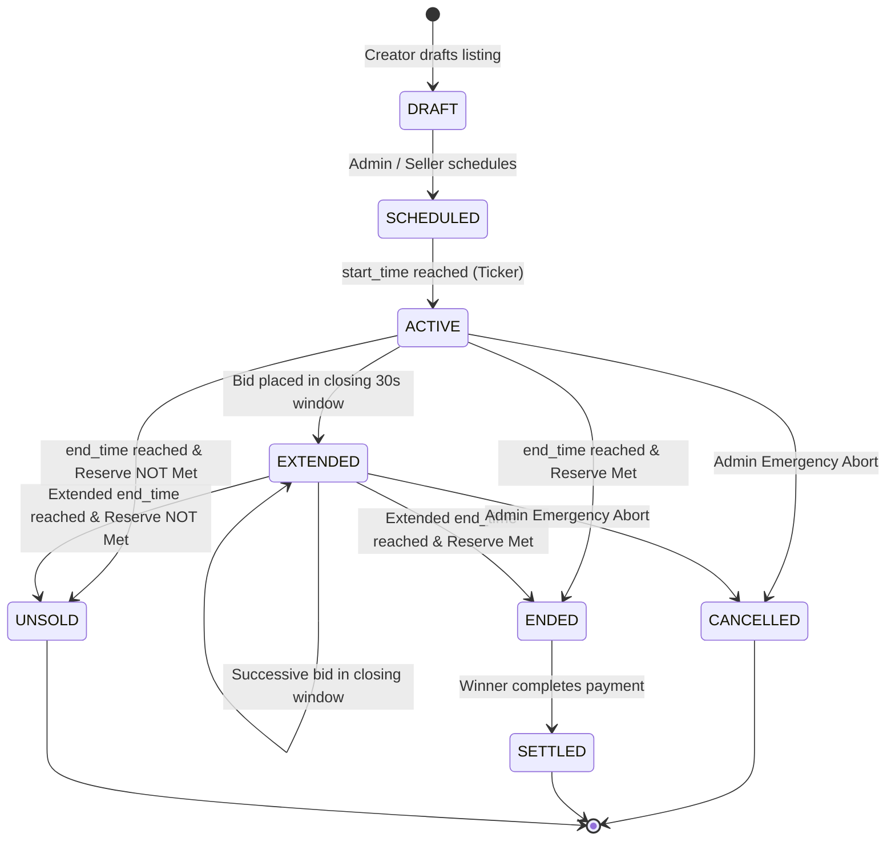

# System Architecture & Technical Design Document

## 1. Executive Summary

**MotoBid** is a production-grade, real-time live auction platform designed specifically for used motorcycles. It is engineered to solve the hardest technical challenges in live digital auctions:
1. **High Contention & Race Conditions**: Eliminating race conditions and stale bids when hundreds of buyers or bots bid in the final milliseconds.
2. **Anti-Sniping (Soft Close)**: Preventing automated bot snipes at $T - 1\text{s}$ through a dynamic extension engine that guarantees fair human price discovery.
3. **Sub-Millisecond Real-Time Latency**: Streaming bi-directional bid events, countdown synchronizations, and outbid alerts via native RFC 6455 WebSockets.
4. **Operational Observability**: First-class Prometheus metrics (`/metrics`), sub-millisecond p95 latency tracking, structured JSON correlation logging, and an immutable audit trail.

---

## 2. High-Level Architecture

The platform adopts a **Modular Monolith** pattern with strict hexagonal domain boundaries:

```
┌────────────────────────────────────────────────────────────────────────┐
│                        React Single Page App (Vite)                    │
│   - Live Auction Arena        - Admin SRE Telemetry    - Sound FX Synth│
│   - Real-time Bid Stream      - Multi-Auction Lobby    - Bot Simulator │
└──────────────────┬───────────────────────────────────┬─────────────────┘
                   │ HTTP/REST (Zod Validated)         │ WebSocket (Frames)
                   ▼                                   ▼
┌────────────────────────────────────────────────────────────────────────┐
│                      Express Gateway & Observability                   │
│   - Request Tracing (x-request-id)   - Sliding-Window Rate Limiter     │
│   - JWT / RBAC Middleware            - Prometheus /metrics Exporter    │
└──────────────────┬───────────────────────────────────┬─────────────────┘
                   │                                   │
                   ▼                                   ▼
┌──────────────────────────────────────┐ ┌───────────────────────────────┐
│     High-Concurrency Bidding Engine  │ │   WebSocket Room Broker       │
│  - Per-Auction Keyed Mutex Lock      │ │   - auction:{id} Room Pub/Sub │
│  - Monotonic Sequence Versioning     │ │   - Targeted OUTBID Messages  │
│  - Dynamic Anti-Sniping Soft-Close   │ │   - 30s Heartbeat Ping/Pong   │
└──────────────────┬───────────────────┘ └───────────────────────────────┘
                   │
                   ▼
┌──────────────────────────────────────┐ ┌───────────────────────────────┐
│     Auction Lifecycle Ticker         │ │   Immutable Audit Logger      │
│  - 500ms Drift-Free State Machine    │ │   - Append-Only Audit Trail   │
│  - Reserve Price Evaluation          │ │   - Cryptographic / Actor Log │
└──────────────────┬───────────────────┘ └──────────────┬────────────────┘
                   │                                    │
                   └─────────────────┬──────────────────┘
                                     ▼
                   ┌──────────────────────────────────┐
                   │ Transactional SQLite (WAL Mode)  │
                   │  - ACID Durability, Zero Spoil   │
                   │  - Microsecond Local Read/Write  │
                   └──────────────────────────────────┘
```

---

## 3. Concurrency Control & Bidding Linearizability

### The Problem
During the closing seconds of an auction, dozens of buyers and automated sniping bots dispatch bids concurrently. A naive database read-modify-write without synchronization causes:
- **Lost Updates**: Two bids reading `current_price = $20,000` both approve `$20,500`.
- **Corrupted Sequences**: Duplicate or out-of-order sequence numbers in the bid stream.
- **Negative Increments**: Stale bids accepted after a higher bid was committed.

### The Solution: Per-Auction Keyed Mutex Lock (`AsyncKeyedLock`)
Rather than locking the entire database (which starves concurrent auctions) or relying solely on optimistic locking (which causes high abort rates and poor UX under contention), MotoBid uses an **In-Memory Per-Auction Keyed Mutex**:

```typescript
export class AsyncKeyedLock {
  private lockQueues: Map<string, Promise<void>> = new Map();

  async acquire<T>(key: string, task: () => Promise<T> | T): Promise<T> {
    const previousPromise = this.lockQueues.get(key) || Promise.resolve();
    let releaseLock: () => void;
    const currentPromise = new Promise<void>((resolve) => {
      releaseLock = resolve;
    });

    this.lockQueues.set(key, previousPromise.then(() => currentPromise));
    try {
      await previousPromise;
      return await task();
    } finally {
      releaseLock!();
      if (this.lockQueues.get(key) === currentPromise) {
        this.lockQueues.delete(key);
      }
    }
  }
}
```

### Guarantees
1. **Strict Linearizability**: Every bid on `auction_id = X` is executed in exact arrival order.
2. **Zero Contention Cross-Talk**: A high-contention bid battle on Ducati Panigale has zero impact on latency for a bid on Yamaha R1M.
3. **Atomic Micro-Transactions**: Under the lock, the current price is verified, user deposit is checked, anti-sniping is evaluated, the bid is inserted with `sequence_num + 1`, and the auction row is updated in a single ACID transaction.

---

## 4. Anti-Sniping (Soft-Close) Engine

Traditional fixed-deadline auctions suffer from **last-second bot sniping**, where automated scripts submit bids at $T - 500\text{ms}$, preventing legitimate human bidders from reacting.

### MotoBid Soft-Close Algorithm
```
Input: Bid placed at timestamp T_bid with Amount A
Let T_end = Current auction end time
Let Window = ANTI_SNIPE_WINDOW_MS (30 seconds)
Let Extension = EXTENSION_DURATION_MS (60 seconds)
Let MaxExtensions = 15

If (T_end - T_bid) <= Window AND ExtensionCount < MaxExtensions:
    T_end_new = T_bid + Extension
    ExtensionCount = ExtensionCount + 1
    AuctionStatus = 'EXTENDED'
    Emit AUCTION_EXTENDED(T_end_new, ExtensionCount)
    Emit Metric: anti_sniping_extensions_total.inc()
    Record Audit: BID_PLACED_AND_EXTENDED
Else:
    T_end_new = T_end
```

This guarantees that whenever price discovery occurs in the closing moments, all participants receive an additional 60-second window to evaluate and submit a counter-bid.

---

## 5. Auction Lifecycle State Machine



### Background Drift-Free Ticker
A background timer runs every 500ms to evaluate state transitions. Rather than relying on cumulative `setTimeout` drift, it performs idempotent declarative queries (`start_time <= datetime('now')` and `end_time <= datetime('now')`), automatically updating auction statuses and broadcasting `STATUS_CHANGED` events.

---

## 6. Observability & SRE Operations

### 6.1 Prometheus Metrics Model (`/metrics`)
MotoBid exports standard production metrics in Prometheus text exposition format:
- `motobid_http_requests_total{method, route, status}`: Request counter.
- `motobid_http_request_duration_seconds{method, route, status}`: Histogram buckets for latency.
- `motobid_bids_processed_total{status}`: Bids processed categorized by outcome (`accepted`, `rejected_stale`, `below_minimum_increment`, `self_outbid_rejected`, `insufficient_deposit`).
- `motobid_bid_processing_duration_seconds`: Histogram tracking mutex lock + persistence duration (typically $< 1\text{ ms}$).
- `motobid_ws_active_connections`: Live gauge of connected WebSocket clients.
- `motobid_active_auctions_total`: Active live auctions gauge.
- `motobid_anti_sniping_extensions_total`: Total soft-close extensions triggered.

### 6.2 Health Probes
- `GET /health`: Comprehensive status, including database latency in milliseconds, heap memory, and uptime.
- `GET /health/live`: Lightweight liveness probe for Kubernetes / Docker restart policies.
- `GET /health/ready`: Readiness probe verifying read/write database responsiveness.

### 6.3 Immutable Audit Trail
Every critical system action is written to an append-only `audit_logs` table:
`[id, timestamp, actor_id, actor_role, action, target_entity, target_id, details, ip_address]`.
The Admin UI includes a live filterable Audit Trail Explorer with search and JSON payload inspection.

---

## 7. Security Best Practices

1. **Authentication**: JWT tokens signed with HMAC-SHA256, carrying user role and claims, verified via `requireAuth` middleware.
2. **Password Security**: Passwords salted and hashed with `bcryptjs` (cost factor 10).
3. **Role-Based Access Control (RBAC)**:
   - `BUYER`: Browse auctions, place bids, view watchlist, manage deposit.
   - `SELLER`: Create listings, configure reserve prices.
   - `ADMIN`: Manage auctions, manual time extensions, force close, view metrics, inspect audit logs, run load simulator.
4. **Reserve Price Masking**: Non-admin users cannot see the seller's secret reserve price until the reserve is met or the auction concludes.
5. **Rate Limiting**: Sliding-window rate limiter protecting against automated spamming (`standardApiLimiter` for generic routes, `bidSubmissionLimiter` capping 60 bids/min per user).
6. **Input Validation**: Strict runtime schema parsing using **Zod** for all REST payloads and WebSocket frames.
